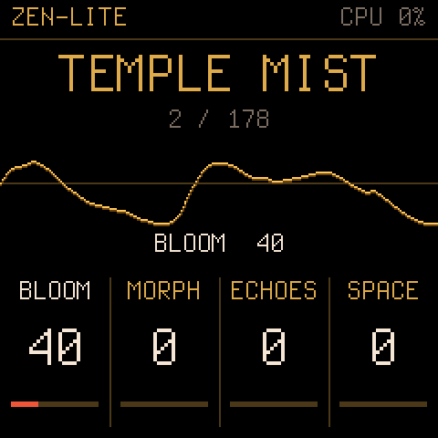

# Zen-Lite

The [Zenthesizer](https://github.com/Hi-Fi-Hopes/Zenthesizer), cut down to run on the M-VAVE FM-1.
Custom firmware, built on [Dinghy](https://github.com/zvenson/dinghy) (Felucca's and SLOOP's platform), so the
FM-1 keeps its updater, its USB rescue and its way back to the official firmware.



## Status: 1.1

Six voices of the plugin's two engines into its ladder filter, with its envelopes, modulation, effects and
look-ahead limiter at -1 dBFS, and 179 of its presets:

- **Engine A**: three analog oscillators, saw / square / triangle / sine, SHAPE (softens the saw, narrows the
  square, folds the triangle, self-FM on the sine), DETUNE (spreads the two side oscillators), LEVEL
- **Engine B**: the four wavetables (AIR, GLASS, VOX, REED), POSITION scanning their eight frames, WARP, LEVEL
- **Filter**: the 4-pole ladder with DRIVE, ENV AMT (ENV 1, either way) and KEY TRACK
- **Modulation**: ENV 1 and ENV 2, two LFOs (sine, triangle, saw, square, drift), a smoothed random, and 12 slots,
  source to destination, as the plugin's. Sources: the envelopes, LFOs, random, velocity, pressure (poly and
  channel), mod wheel, slide (CC 74), the key, and the four plates. Destinations: pitch, A tune / detune / shape /
  level, B position / warp / level, cutoff, resonance, drive, amp, pan, the LFO rates and the effect mixes
- **The plates** BLOOM, MORPH, ECHOES, SPACE are the HOME page's knobs: macros, through the plugin's plate kit in
  slots 1-7 (BLOOM opens the filter, MORPH moves B's position, ECHOES brings in the delay, SPACE the reverb)
- **Effects**: the plugin's chorus, ping-pong delay (up to 1.48 s, with its tape wow) and shimmer reverb (the delay
  and reverb run at half the sample rate), VOLUME, and a SPEAKER setting for the FM-1's speaker
- **Presets**: the PRESETS encoder steps through Zenthesizer's factory presets, converted
  (`tools/make_presets.sh`). Left out, as there is no engine for them here: B UNISON, AIR (breath noise) and the
  arpeggiator. The 26 presets built on the plucked STRING oscillator are skipped. A synced delay becomes the same
  time at 90 BPM, the plugin's tempo without a host. Every preset plays within 3 dB of the plugin's level
  (`tests/check_audio.sh`); those that leaned on unison sound thinner.
- **The keyboard** plays the key: white keys are the scale, black keys the seven chords

Integer maths only (the FM-1 has no FPU); every curve is computed once by `tools/gen_tables.py` from the plugin's
own formulas. Every build compares the sound with the plugin's own engine (38 cases, and every preset), and every chord with its
chord builder.

### The keyboard (SCALE keys)

| Keys | Do |
| --- | --- |
| White keys | the notes of the key and scale, the root on the leftmost |
| Black keys 1-7 (F#3 .. G#4) | the seven chords of the key, I to vii, as the plugin builds them |
| Black keys 8-11 (A#4, C#5, D#5, F#5), held | 7TH, 9TH, SUS, STRUM for the next chord |
| SEL | CHROMATIC keys (every key its own note, as a piano) and back |

Chord notes are the first to give way when all six voices are busy, so a melody over a chord keeps sounding.

### Pages

A second press of a button steps to its next page.

| Button | Page | KNOB 1 | KNOB 2 | KNOB 3 | KNOB 4 |
| --- | --- | --- | --- | --- | --- |
| HOME | the preset | BLOOM | MORPH | ECHOES | SPACE |
| EDIT | FILTER | CUTOFF | RESONANCE | DRIVE | ENV AMT |
| | ENGINE A | WAVE | SHAPE | DETUNE | LEVEL |
| | ENGINE B | TABLE | POSITION | WARP | LEVEL |
| | VOICE | TUNE | GLIDE | VEL SENS | VOLUME |
| ENV | AMP ENV, ENV 1, ENV 2 | ATTACK | DECAY | SUSTAIN | RELEASE |
| LFO | LFO | 1 RATE | 1 SHAPE | 2 RATE | 2 SHAPE |
| | RANDOM + KEY | RANDOM (rate) | SMOOTH | KEY TRACK | STEREO |
| | MOD | SLOT (1-12) | SOURCE | DEST | AMOUNT |
| FX | FX | CHORUS | REVERB | DECAY | SHIMMER |
| | SPACE | SIZE | DAMP | DEPTH (chorus) | SPEAKER: FLAT, SOFT, LOW CUT |
| | DELAY | TIME | FEEDBACK | TONE | MIX |
| GLO | KEY + SCALE | KEY | SCALE | KEYS | SPREAD |
| ARP | ARP | MODE: OFF, UP, DOWN, UP-DOWN, RANDOM, AS PLAYED | RATE: 1/4 .. 1/32 (with triplets) | OCTAVES 1-4 | GATE |
| | TEMPO | BPM | HOLD | SYNC: INTERNAL, MIDI CLOCK | CLEAR (the sequence: four clicks right) |
| SEQ | SEQUENCER | STEP (the one REC writes next) | LENGTH 1-16 | RATE | GATE |
| GLO again | CONTROLLER | PADS (learn) | KNOBS (learn) | PAD CH (any, 1-16) | RESET (four clicks right) |

### A MIDI controller (a Launchkey Mini MK4, say)

MIDI comes in over USB **and the 3.5 mm TRS MIDI IN jack** (the TRS driver is Melodee's). A controller's pads play the
chord keys and its knobs set eight settings; set up for a Novation Launchkey in standalone mode out of the box:

- **Pads** (channel 10, from note 36): the seven chords I .. vii, then 7TH, 9TH, SUS and STRUM, held as the black keys
  8-11 are (the FM-1's own modifier keys work with the pads too).
- **Knobs** (CC 21-28): BLOOM, MORPH, ECHOES, SPACE, CUTOFF, RESONANCE, DELAY MIX, REVERB MIX.
- Another controller, or another layout: GLO twice, then **PADS** (turn right): press the pads for I, ii, iii, IV, V,
  vi, vii, 7TH, 9TH, SUS, STRUM in turn (the first sets the channel); **KNOBS**: turn the eight knobs in turn.
  **RESET** brings the Launchkey's back. Everything else from the controller (its keys, pitch and mod strips,
  pressure) plays as any MIDI does.
- A Type A TRS cable (a plain 3.5 mm stereo cable between two Type A jacks): the Launchkey Mini MK4 is Type A.

### The arpeggiator and the sequencer

- **The arp** (the plugin's): set a MODE and play. Held keys, chords from the black keys and MIDI notes are
  arpeggiated, one note at a time, over 1-4 octaves. HOLD keeps the pattern going after you let go, until you play
  again. ARP lights while the arp is on.
- **The sequencer**: 16 steps, each a note or a chord (up to six notes). **REC** (lit) writes steps from the STEP
  card on: play a note or a black-key chord, and when you let go it is written and the next step comes up. **SEQ**
  while recording writes a rest. REC again to stop. **PLAY** plays the sequence from step 1, and stops it. The
  sequencer page shows the 16 steps, the one being written outlined, the one playing lit. The sequence is saved
  with the settings.
- **Tempo**: BPM, or SYNC to MIDI CLOCK (from Ableton, say). On MIDI clock, start and stop play and stop the
  sequence and the arp follows the clock. Both run in the audio interrupt, so the screen cannot make them stagger:
  on the computer they land within 4 ms of the beat.

Turning PRESETS loads a preset at once (the plates go back to 0; key, scale and SPEAKER stay). Edits are kept
(the FM-1 saves them when it is quiet) but there are no user preset slots yet: the next preset turn replaces them.
SPEAKER shapes the headphones and USB audio too: keep it on FLAT when recording.

**The CPU guard**: if the sound ever takes more than 85 % of an audio block, the oldest let-go tail, else the oldest
chord note, else the oldest note fades out in 4 ms (DROP shows on the screen), so the sound never breaks up.

OCT- / OCT+ the octave, MASTER the volume. USB-MIDI in: notes (chromatic, with velocity), pitch bend (+-2
semitones), mod wheel (CC 1), CC 74, channel and poly pressure. The screen's last lines: **CPU**, **LIMIT**,
octave, voices.

### The screen

After the mock-ups, in Zenthesizer's theme and its fonts (Instrument Serif Italic, Instrument Sans):

- **HOME**: the tree-ring slab, the preset's name on its band; its family and number along the top. A ring around
  the bark breathes with the sound (the scope), each note sends a ripple out from the pith, and a bead lights for
  each voice sounding. CPU sits small in the corner.
- **The other pages**: the slab dimmed, the sound burned across it; the chord playing in the serif.
- Along the top a plank with the page's name and the CPU (and the limiter and DROP when they act); along the bottom
  a plank of four cards, one a knob: name, value, bar. Turning a knob lights its card and spells it out in full.
- **SAVE** stops the motion (a still picture) and starts it again.
- **The battery** at the top plank's right end: stock's four levels (0-3 bars, amber at one and none), a bolt
  while a computer is connected over USB.

The pictures and fonts are drawn once on a computer (`tools/gen_art.py`) and stored in the firmware (about 80 KB).
The screen is drawn between audio blocks, from the main loop, and only while something moves or changes; the sound's
code runs from RAM, out of reach of what the drawing does to the flash cache.

## Install, test, go back

Chrome or Edge, the FM-1 on USB, Ableton and other MIDI apps closed.

1. Download `zenlite.fwsc` from the [`builds` branch](../../tree/builds) (the newest build of `main`).
   With `curl`: `curl -L -o zenlite.fwsc https://raw.githubusercontent.com/Hi-Fi-Hopes/Zen-Lite/builds/zenlite.fwsc`
2. Install it with any FM-1 web installer that takes a package file, or from a terminal:
   `python3 tools/fm1_install.py zenlite.fwsc` (`pip3 install mido python-rtmidi` once; on Windows use Python 3.12,
   `py -V:3.12 fm1_install.py zenlite.fwsc`, as python-rtmidi has no Windows builds for newer Pythons).
3. Play. Watch CPU on the screen with all six voices sounding.
4. Go back: the [FM-1 Firmware Hub](https://thefirmwarehub.com/)'s **Back to official V15**, or M-VAVE's M-UPGRADE
   with V15. If anything ever hangs: hold **OCT-** while switching on (USB rescue) and install again.

## Build

Every push builds on GitHub (`.github/workflows/build.yml`): the package, a host render and a comparison against
the plugin's own engine. Locally (Linux x86-64, or Docker): see `docs/` and `tools/get_toolchain.sh`, then
`./build.sh`. On the computer, no FM-1 needed:

```sh
sh tests/run_host.sh                                    # build/host/zenlite.wav and screens
ZEN_SRC=../Zenthesizer sh tests/check_audio.sh          # Zen-Lite vs the plugin: 38 cases, every preset
ZEN_SRC=../Zenthesizer sh tools/make_presets.sh         # firmware/gen/zen_presets.h from the plugin's presets
```

Package identity `FM-1_950`. GPL-3.0-only; credits in `LICENSING.md`.
